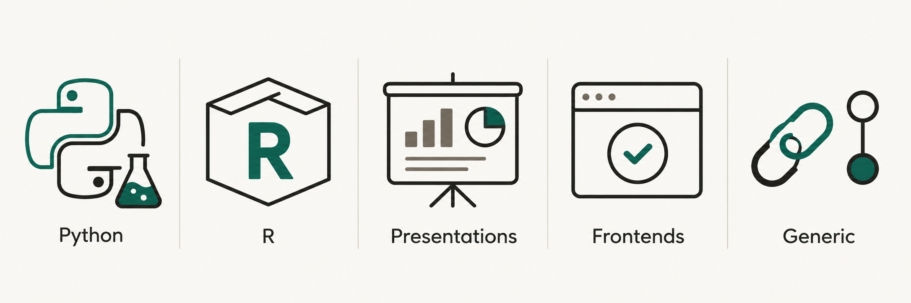

# Reusable GitHub Actions Workflows

> [!WARNING]
> These workflows are for repositories owned by
> [@IndrajeetPatil](https://github.com/IndrajeetPatil). They enforce that owner
> guard and are not intended as general-purpose templates.

Reusable workflows for package checks, documentation, presentations and
frontend quality gates. Callers reference `@main`; changes here reach them
after a pull request passes this repository's security checks.



| Family | Use it for | Workflows |
| --- | --- | --- |
| Python | Package tests, quality checks and docs | [Python catalogue](docs/workflow-catalogue.md#python-packages) |
| R | Package checks, sites, coverage and releases | [R catalogue](docs/workflow-catalogue.md#r-packages) |
| Presentations | Quarto RevealJS builds and deployment | [Presentation catalogue](docs/workflow-catalogue.md#presentations) |
| Frontends | One shared Vite+ quality gate | [Frontend guide](docs/frontend-qa.md) |
| Generic | Link and commit checks | [Generic catalogue](docs/workflow-catalogue.md#generic) |

## Quick start

Add a caller workflow in your repository:

```yaml
on:
  pull_request:
    branches: [main]

jobs:
  format:
    uses: IndrajeetPatil/workflows/.github/workflows/check-formatting.yaml@main
```

Grant the caller only the token permissions its selected workflow needs. See
[usage and security](docs/using-workflows.md) for inputs, selected-action
policies and secret handling.

## Detailed guides

- [Workflow catalogue](docs/workflow-catalogue.md): every reusable workflow and its inputs.
- [Frontend QA](docs/frontend-qa.md): gate order, baseline hooks and optional commands.
- [R package workflows](docs/r-packages.md): hard-dependency caches and the CRAN release boundary.

## License

[MIT](LICENSE)
