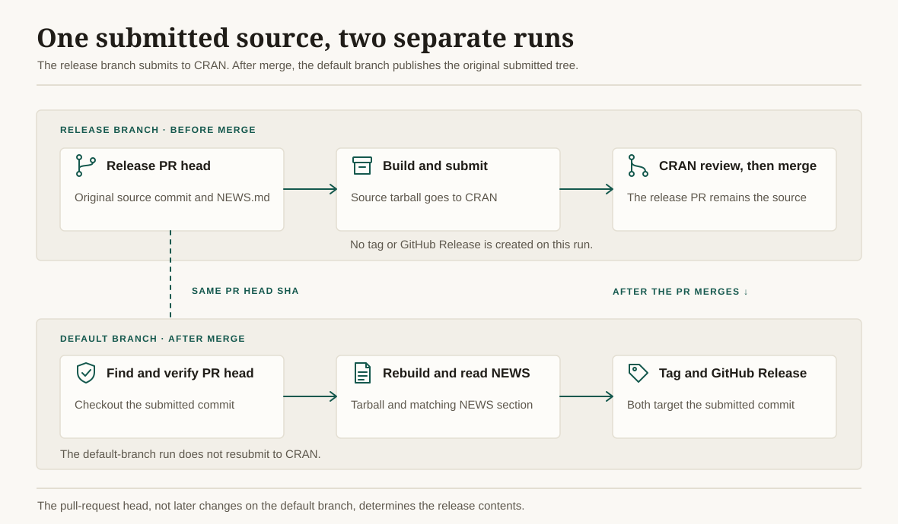
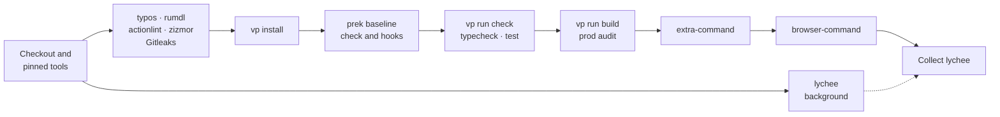

# Reusable GitHub Actions Workflows

> [!WARNING]
> These workflows are intended solely for use by
> [@IndrajeetPatil](https://github.com/IndrajeetPatil) repositories. They are
> tuned to specific personal conventions and are not designed for general use.
> Workflows will explicitly fail if called from a repository not owned by
> `IndrajeetPatil`.

Reusable [GitHub Actions workflows](https://docs.github.com/en/actions/sharing-automations/reusing-workflows) for [IndrajeetPatil](https://github.com/IndrajeetPatil) repositories.

All external actions are **pinned to commit SHAs** to prevent supply chain
attacks. The workflows default to read-only token access, disable persisted
checkout credentials except for the one intentional push job, and bound every
job with a timeout. Write credentials are isolated in deployment and release
jobs rather than exposed while repository code and dependencies are built or
tested.

The repository's only standalone workflow is
[`security.yml`](.github/workflows/security.yml). It runs on pull requests to
`main`, scans the complete Git history with Gitleaks, and audits every workflow
with zizmor in pedantic mode so future changes cannot silently weaken these
controls.

Most R package workflows are **check-only** — they validate code but never
modify or auto-commit changes. Some workflows do perform deployment or release
actions, including [`pkgdown.yaml`](.github/workflows/pkgdown.yaml), which
deploys the pkgdown site to `gh-pages`, and
[`submit-cran.yaml`](.github/workflows/submit-cran.yaml), which builds and
submits a source tarball from a release branch and creates a GitHub Release only
when rerun from the default branch after merge, in a separate least-privilege
job. The post-merge run rebuilds and tags the original submitted pull-request
head so unrelated changes merged during CRAN review cannot enter the release.

## Usage

Reference a reusable workflow from your repository:

```yaml
on:
  push:
    branches: [main, master]
  pull_request:
    branches: [main, master]

jobs:
  format:
    uses: IndrajeetPatil/workflows/.github/workflows/check-formatting.yaml@main
```

For workflows with inputs:

```yaml
jobs:
  R-CMD-check:
    uses: IndrajeetPatil/workflows/.github/workflows/R-CMD-check.yaml@main
    with:
      hard: true
```

Reference these workflows by `@main`. They are maintained alongside their
callers, so a branch reference delivers fixes to every caller at once instead
of leaving SHA pins to go stale. The safeguard is on this side: `main` accepts
changes only through pull requests that pass the Gitleaks and zizmor checks.
Callers that run zizmor should allow this with a narrow policy and keep every
third-party action SHA-pinned:

```yaml
# .github/zizmor.yml
rules:
  unpinned-uses:
    config:
      policies:
        "IndrajeetPatil/*": ref-pin
        "*": hash-pin
```

Callers must also grant only the permissions required by the selected
workflow. GitHub can maintain or reduce permissions through a reusable-workflow
chain, but a called workflow cannot elevate scopes that its caller did not
grant.

A reusable workflow runs under the **caller's** Actions policy. A caller that
allows only selected actions must allow `IndrajeetPatil/*` and every
third-party action the workflow uses; for the frontend workflows that is
`voidzero-dev/setup-vp`, `j178/prek-action` and `astral-sh/setup-uv`, plus
GitHub-owned actions.

Avoid `secrets: inherit` when a workflow needs only one named secret. Pass that
secret explicitly so unrelated repository or organization secrets are not made
available to the called workflow.

## Python Packages

| Workflow | Description | Inputs |
|----------|-------------|--------|
| [`python-docs.yaml`](.github/workflows/python-docs.yaml) | Build & deploy Python package documentation to GitHub Pages | — |
| [`python-qa.yaml`](.github/workflows/python-qa.yaml) | Code Quality checks, including build and test coverage | — |
| [`python-test.yaml`](.github/workflows/python-test.yaml) | Run Tests across multiple OS and Python versions | — |

The repository's internal zizmor audit enables ANSI color in captured CI logs
with job-level `FORCE_COLOR=1` and `CLICOLOR_FORCE=1`, while retaining its
GitHub annotation format. In the reusable Python and presentation workflows,
color is strictly enabled via command-line flags on `uv` and `pytest`
rather than job-level variables. This prevents ANSI escapes from bleeding into
caller-supplied content such as `prek` hooks, Make targets, or captured
presentation cells. `prek` itself remains colorized via the `prek-action` defaults.

## R Packages

| Workflow | Description | Inputs |
|----------|-------------|--------|
| [`check-docs.yaml`](.github/workflows/check-docs.yaml) | Check for broken links using [lychee](https://github.com/lycheeverse/lychee) and spelling using [typos](https://github.com/crate-ci/typos) | — |
| [`check-formatting.yaml`](.github/workflows/check-formatting.yaml) | Check and suggest code formatting using [air](https://github.com/posit-dev/air) | — |
| [`R-CMD-check.yaml`](.github/workflows/R-CMD-check.yaml) | R CMD check across multiple operating systems plus current, devel, and previous R releases; use `hard: true` for a hard-deps-only CI check (PR-only) | `hard` |
| [`check-extra.yaml`](.github/workflows/check-extra.yaml) | Parallel extra checks: no-warnings, random test order, README render | `extra-packages` |
| [`lint.yaml`](.github/workflows/lint.yaml) | Package linting with `{lintr}` | — |
| [`pkgdown.yaml`](.github/workflows/pkgdown.yaml) | Build & deploy a pkgdown site with verified canonical URLs; use `no-suggests: true` for a hard-deps-only CI check | `no-suggests` |
| [`pre-commit.yaml`](.github/workflows/pre-commit.yaml) | Run pre-commit hooks; fails if hooks would modify files | — |
| [`seo-files.yaml`](.github/workflows/seo-files.yaml) | Deploy SEO and AI-discovery files (`robots.txt`, `.well-known/llms.txt`) to `gh-pages` after pkgdown build | `package-name` |
| [`submit-cran.yaml`](.github/workflows/submit-cran.yaml) | On a release branch, build and submit to CRAN without releasing; on the default branch after merge, rebuild and tag the submitted PR head and create a GitHub Release using the matching `NEWS.md` section without resubmitting | `extra-packages` |
| [`test-coverage.yaml`](.github/workflows/test-coverage.yaml) | Two parallel coverage jobs: unit tests (enforces 100%) + examples/vignettes (enforces 100%) | — |

Declare package-specific checking tools in `Config/Needs/check` in the caller's
`DESCRIPTION`. `R-CMD-check.yaml` installs these entries in both normal and
hard-dependency modes.

### Hard-dependency checks

Setting `no-suggests: true` makes `pkgdown.yaml` validate that a package website
can be built with hard package dependencies plus the documentation tooling,
without installing the package's `Suggests`. Likewise, `hard: true` makes
`R-CMD-check.yaml` run R CMD check with only hard dependencies and checking
tools. Each job uses its own dedicated cache namespace that includes a hash of
the caller's `DESCRIPTION`. This matters
because `setup-r-dependencies` fallback cache keys do not include the generated
lockfile hash: sharing the normal pkgdown namespace, or reusing a hard-only
namespace after declared dependencies change, could restore packages that are
no longer hard dependencies and weaken the check.

The first run for each `DESCRIPTION` state is necessarily a cold install. Later
runs with the same dependency metadata can restore that isolated cache,
avoiding the much longer runtime caused by rebuilding the hard-dependency graph
on every pull request. Increment the static cache-generation prefix only when
all hard-only caches intentionally need to be invalidated.

### CRAN release lifecycle

The release branch submits its source tarball to CRAN while the release pull
request is open. After that pull request merges, rerun `submit-cran.yaml` from
the default branch to create the tag and GitHub Release from the original
submitted pull-request head. The second run rebuilds the tarball and reads the
matching `NEWS.md` section from that same commit.



## Presentations

| Workflow | Description | Inputs |
|----------|-------------|--------|
| [`build-presentation-python.yaml`](.github/workflows/build-presentation-python.yaml) | Build & deploy Python/UV Quarto RevealJS presentation to GitHub Pages | — |
| [`build-presentation-r.yaml`](.github/workflows/build-presentation-r.yaml) | Build & deploy R Quarto RevealJS presentation to GitHub Pages | — |

## Frontends

| Workflow | Description | Inputs |
|----------|-------------|--------|
| [`frontend-qa.yaml`](.github/workflows/frontend-qa.yaml) | Standardized quality gate for [Vite+](https://viteplus.dev) frontends: spelling, Markdown, workflow lint and audit, secret scan, prek hooks, format/lint/types, unit tests, production build, dependency audit and link check | `working-directory`, `test`, `python`, `lychee-args`, `extra-command`, `browser-command`, `timeout-minutes` |

Every caller gets the same baseline gates; inputs can only **add**
project-specific gates or adapt the layout, never remove a baseline check.
The one exception is `test: false`, for a frontend that has no unit tests.

### Gates

The workflow runs a single job, cheapest checks first, so a failure stops
before the expensive steps. GitHub bills each job rounded up to the minute and
every job repeats checkout and setup, so one sequential job costs less than a
fan-out. The network-bound link check starts in the background straight after
checkout and is collected last, so it adds almost no wall-clock time.



| Gate | Tool | Caller configuration |
|------|------|----------------------|
| Spelling | [typos](https://github.com/crate-ci/typos) | `_typos.toml` |
| Markdown | [rumdl](https://github.com/rvben/rumdl) | `.rumdl.toml` |
| Workflow correctness | [actionlint](https://github.com/rhysd/actionlint) (with shellcheck) | `.github/actionlint.yaml` |
| Workflow security | [zizmor](https://github.com/zizmorcore/zizmor), online audits | `.github/zizmor.yml` |
| Secrets in full history | [Gitleaks](https://github.com/gitleaks/gitleaks) | `.gitleaks.toml` |
| Hook baseline | `prek list`: every caller declares the baseline hooks below | `prek.toml` or `.pre-commit-config.yaml` (required) |
| Repository hooks | [prek](https://github.com/j178/prek), pre-commit stage, all files | same |
| Format, lint, types | `vp run check` | Vite+ task (required) |
| Astro and TypeScript types | `vp run typecheck` | Vite+ task (required) |
| Unit tests and coverage | `vp run test` | Vite+ task (required unless `test: false`) |
| Production build | `vp run build` | Vite+ task (required) |
| Production dependency advisories | `vp pm audit -- --prod` | — |
| Link rot | [lychee](https://github.com/lycheeverse/lychee) | `lychee.toml` |

### Baseline hooks

Each caller's prek configuration must declare these hook ids, so every
repository gives the same fast feedback before code leaves the machine. Add
project-specific hooks freely.

| Stage | Hook ids |
|-------|----------|
| `pre-commit` | `trailing-whitespace`, `end-of-file-fixer`, `fix-byte-order-marker`, `mixed-line-ending`, `check-merge-conflict`, `check-case-conflict`, `check-yaml`, `check-toml`, `check-json`, `check-added-large-files`, `detect-private-key`, `check-shebang-scripts-are-executable`, `check-executables-have-shebangs`, `check-symlinks`, `destroyed-symlinks`, `check-illegal-windows-names`, `forbid-submodules`, `no-commit-to-branch`, `gitleaks`, `typos`, `rumdl-check`, `vite-plus` |
| `commit-msg` | `conventional-pre-commit` |
| `pre-push` | `typecheck`, `test` |

> [!TIP]
> prek's `builtin` repository implements most hygiene hooks natively, with no
> Python environment. `forbid-submodules` is not built in; declare it as a
> local hook with `language = "fail"` and `types = ["directory"]`.

In CI, only the `vite-plus` hook is skipped, because the next step runs the
same `vp run check`. Every other hook runs on all files; the rest of the
duplicates (typos, rumdl, the staged-only Gitleaks scan) take seconds.

Rust and Go tools are installed from release binaries verified against pinned
SHA-256 checksums, which takes seconds rather than a Node or Python install.

### Optional gates

- `extra-command` runs project-specific gates after the build, such as Python
  linting, dead-code analysis or CSS metrics. Set `python: true` when these, or
  the prek hooks, need uv.
- `browser-command` runs browser audits last, such as axe-core or Lighthouse,
  against the runner's Google Chrome. Browser audits are the slowest gates, so
  they are opt-in. Do not upload reports to public storage from a private
  repository.
- `working-directory` points at a frontend that lives in a subdirectory.
  Vite+ steps run there; repository-wide checks still run from the root.

### Example

Run the gate on pull requests only. When the default branch accepts changes
solely through pull requests, re-running it on the merged commit spends
minutes on a verdict that is already known.

```yaml
name: Frontend QA

on:
  pull_request:
    branches: [main]
  workflow_dispatch:

permissions:
  contents: read

concurrency:
  group: frontend-qa-${{ github.ref }}
  cancel-in-progress: true

jobs:
  frontend-qa:
    uses: IndrajeetPatil/workflows/.github/workflows/frontend-qa.yaml@main
    with:
      python: true
      extra-command: make lint-python
```

The required status check is named `frontend-qa / Frontend QA`.

## Generic

Generic workflows are language-agnostic and provide utility across diverse
types of projects, ensuring high code quality and robust documentation
regardless of the underlying tech stack.

| Workflow | Description | Inputs |
|----------|-------------|--------|
| [`check-link-rot.yaml`](.github/workflows/check-link-rot.yaml) | Check for broken links using [lychee](https://github.com/lycheeverse/lychee) | — |
| [`conventional-commits.yaml`](.github/workflows/conventional-commits.yaml) | Check every pull-request commit and the pull-request title (the default squash subject) against [Conventional Commits](https://www.conventionalcommits.org) | `extra-types`, `strict` |

Trigger `conventional-commits.yaml` on the `edited` pull-request activity as
well, so a corrected title is re-checked. Keep it in its own caller workflow:
an `edited` trigger on a heavier workflow would re-run all of it for a title
change.

```yaml
on:
  pull_request:
    branches: [main]
    types: [opened, synchronize, reopened, edited]

permissions:
  contents: read

concurrency:
  group: conventional-commits-${{ github.ref }}
  cancel-in-progress: true

jobs:
  conventional-commits:
    uses: IndrajeetPatil/workflows/.github/workflows/conventional-commits.yaml@main
```

## License

[MIT](LICENSE)
