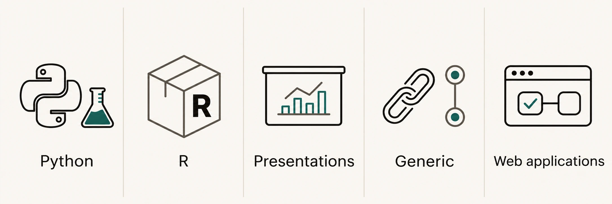

# Reusable GitHub Actions Workflows

> [!WARNING]
> These workflows are for repositories owned by
> [@IndrajeetPatil](https://github.com/IndrajeetPatil). They enforce that owner
> guard, so they fail in any other account's repositories, and they are not
> intended as general-purpose templates. This documentation describes how the
> owner's repositories use them; it is not a set-up guide for other users.

Reusable workflows for package checks, documentation, and presentations.
Callers reference `@main`; changes here reach them after a pull request
passes this repository's security and prek checks.



| Family | Purpose | Workflows |
| --- | --- | --- |
| Python | Package tests, quality checks, and docs | [Python catalogue](docs/workflow-catalogue.md#python-packages) |
| R | Package checks, benchmarks, sites, coverage, and releases | [R catalogue](docs/workflow-catalogue.md#r-packages) |
| Presentations | Quarto RevealJS builds and deployment | [Presentation catalogue](docs/workflow-catalogue.md#presentations) |
| Generic | Link and commit checks | [Generic catalogue](docs/workflow-catalogue.md#generic) |

## Quick start

A caller workflow in one of the owner's repositories looks like this:

```yaml
on:
  pull_request:
    branches: [main]

jobs:
  format:
    uses: IndrajeetPatil/workflows/.github/workflows/check-formatting.yaml@main
```

Grant the caller only the token permissions its selected workflow needs. See
[usage and security](docs/using-workflows.md) for inputs, selected-action
policies, and secret handling, and [security practices](docs/security.md) for
the security model used by these workflows and their callers.

## Detailed guides

- [Workflow catalogue](docs/workflow-catalogue.md): every reusable workflow and
  its inputs.

- [R package workflows](docs/r-packages.md): dependency caches, hard-dependency
  checks, and the CRAN release boundary.

- [Security practices](docs/security.md): workflow controls, caller
  responsibilities, and security boundaries.

## License

[MIT](LICENSE)
