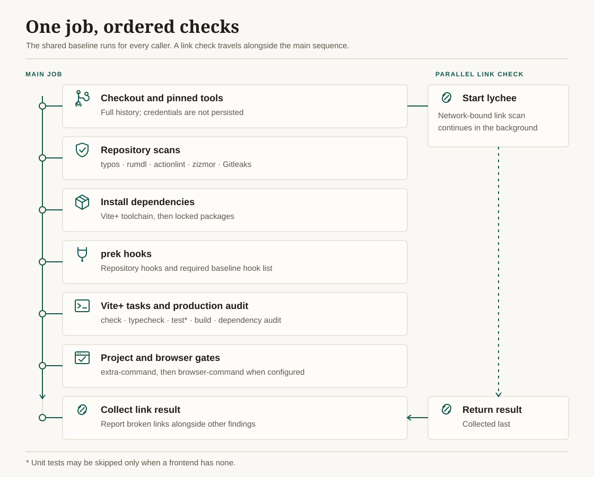

# Frontend QA

| Workflow | Description | Inputs |
|----------|-------------|--------|
| [`frontend-qa.yaml`](../.github/workflows/frontend-qa.yaml) | Standardised quality gate for [Vite+](https://viteplus.dev) frontends: spelling, Markdown, workflow lint and audit, secret scan, prek hooks, format/lint/types, unit tests, production build, dependency audit and link check | `working-directory`, `test`, `python`, `extra-command`, `browser-command`, `timeout-minutes` |

Every caller gets the same baseline gates; inputs can only **add**
project-specific gates or adapt the layout, never remove a baseline check.
The one exception is `test: false`, for a frontend that has no unit tests.

## Gates

The workflow runs a single job, cheapest checks first, so a failure stops
before the expensive steps. GitHub bills each job rounded up to the minute and
every job repeats checkout and setup, so one sequential job costs less than a
fan-out. The network-bound link check starts in the background straight after
checkout and is collected last, so it adds almost no wall-clock time.



| Gate | Tool | Caller configuration |
|------|------|----------------------|
| Spelling | [typos](https://github.com/crate-ci/typos) | `_typos.toml` |
| Markdown | [rumdl](https://github.com/rvben/rumdl) | `.rumdl.toml` |
| Workflow correctness | [actionlint](https://github.com/rhysd/actionlint) (with shellcheck) | `.github/actionlint.yaml` |
| Workflow security | [zizmor](https://github.com/zizmorcore/zizmor), online audits | `.github/zizmor.yml` |
| Secrets in full history | [Gitleaks](https://github.com/gitleaks/gitleaks) | `.gitleaks.toml` |
| Hook baseline | `prek list`: every caller declares the baseline hooks below | `prek.toml` or `.pre-commit-config.yaml` (required) |
| Repository hooks | [prek](https://github.com/j178/prek), pre-commit stage, all files | same |
| Format, lint, types | `vp run check` | Vite+ task (required) |
| Astro and TypeScript types | `vp run typecheck` | Vite+ task (required) |
| Unit tests and coverage | `vp run test` | Vite+ task (required unless `test: false`) |
| Production build | `vp run build` | Vite+ task (required) |
| Production dependency advisories | `vp pm audit -- --prod` | — |
| Link rot | [lychee](https://github.com/lycheeverse/lychee) | `lychee.toml` (the only way to configure it, so local and CI runs match) |

## Baseline hooks

Each caller's prek configuration must declare these hook ids, so every
repository gives the same fast feedback before code leaves the machine. Add
project-specific hooks freely.

| Stage | Hook ids |
|-------|----------|
| `pre-commit` | `trailing-whitespace`, `end-of-file-fixer`, `fix-byte-order-marker`, `mixed-line-ending`, `check-merge-conflict`, `check-case-conflict`, `check-yaml`, `check-toml`, `check-json`, `check-added-large-files`, `detect-private-key`, `check-shebang-scripts-are-executable`, `check-executables-have-shebangs`, `check-symlinks`, `destroyed-symlinks`, `check-illegal-windows-names`, `forbid-submodules`, `no-commit-to-branch`, `gitleaks`, `typos`, `rumdl-check`, `vite-plus` |
| `commit-msg` | `conventional-pre-commit` |
| `pre-push` | `typecheck`, `test` |

> [!TIP]
> prek's `builtin` repository implements most hygiene hooks natively, with no
> Python environment. `forbid-submodules` is not built in; declare it as a
> local hook with `language = "fail"` and `types = ["directory"]`.

In CI, only the `vite-plus` hook is skipped, because the next step runs the
same `vp run check`. Every other hook runs on all files; the rest of the
duplicates (typos, rumdl, the staged-only Gitleaks scan) take seconds.

Rust and Go tools are installed from release binaries verified against pinned
SHA-256 checksums, which takes seconds rather than a Node or Python install.

## Optional gates

- `extra-command` runs project-specific gates after the build, such as Python
  linting, dead-code analysis or CSS metrics. Set `python: true` when these, or
  the prek hooks, need uv.
- `browser-command` runs browser audits last, such as axe-core or Lighthouse,
  against the runner's Google Chrome. Browser audits are the slowest gates, so
  they are opt-in. Do not upload reports to public storage from a private
  repository.
- `working-directory` points at a frontend that lives in a subdirectory.
  Vite+ steps run there; repository-wide checks still run from the root.

## Example

Run the gate on pull requests only. When the default branch accepts changes
solely through pull requests, re-running it on the merged commit spends
minutes on a verdict that is already known.

```yaml
name: Frontend QA

on:
  pull_request:
    branches: [main]
  workflow_dispatch:

permissions:
  contents: read

concurrency:
  group: frontend-qa-${{ github.ref }}
  cancel-in-progress: true

jobs:
  frontend-qa:
    uses: IndrajeetPatil/workflows/.github/workflows/frontend-qa.yaml@main
    with:
      python: true
      extra-command: make lint-python
```

The required status check is named `frontend-qa / Frontend QA`.
