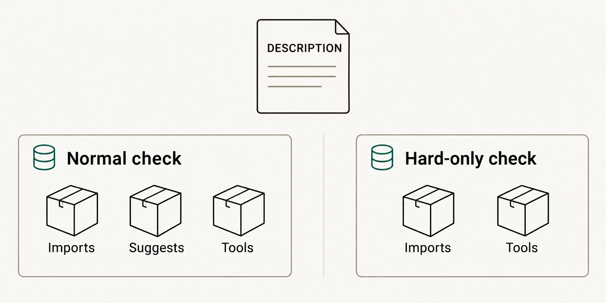

# R package workflow details

See the [R package catalogue](workflow-catalogue.md#r-packages) for the
workflow list and inputs. Declare package-specific checking tools in
`Config/Needs/check` in the caller's `DESCRIPTION`; `R-CMD-check.yaml` installs
them in normal and hard-dependency modes.

## Hard-dependency checks

Setting `no-suggests: true` makes `pkgdown.yaml` validate that a package website
can be built with hard package dependencies plus the documentation tooling,
without installing the package's `Suggests`. Likewise, `hard: true` makes
`R-CMD-check.yaml` run R CMD check with only hard dependencies and checking
tools. Each job uses its own dedicated cache namespace that includes a hash of
the caller's `DESCRIPTION`. This matters
because `setup-r-dependencies` fallback cache keys do not include the generated
lockfile hash: sharing the normal pkgdown namespace, or reusing a hard-only
namespace after declared dependencies change, could restore packages that are
no longer hard dependencies and weaken the check.

The first run for each `DESCRIPTION` state is necessarily a cold install. Later
runs with the same dependency metadata can restore that isolated cache,
avoiding the much longer runtime caused by rebuilding the hard-dependency graph
on every pull request. Increment the static cache-generation prefix only when
all hard-only caches intentionally need to be invalidated.

## CRAN releases

Most R workflows only check code. `pkgdown.yaml` and `seo-files.yaml` deploy to
`gh-pages`; `submit-cran.yaml` submits a release-branch tarball to CRAN and,
after that pull request merges, creates a GitHub Release from its original
head on a separate default-branch run. The release job uses only the write
permission it needs and does not resubmit to CRAN.

### Release lifecycle

The release branch submits its source tarball to CRAN while the release pull
request is open. After that pull request merges, rerun `submit-cran.yaml` from
the default branch to create the tag and GitHub Release from the original
submitted pull-request head. The second run rebuilds the tarball and reads the
matching `NEWS.md` section from that same commit.

