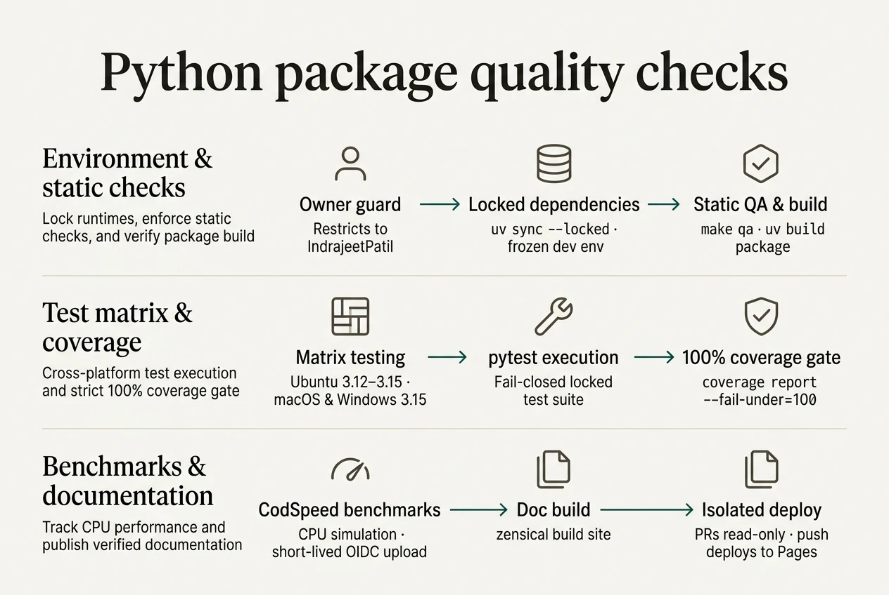
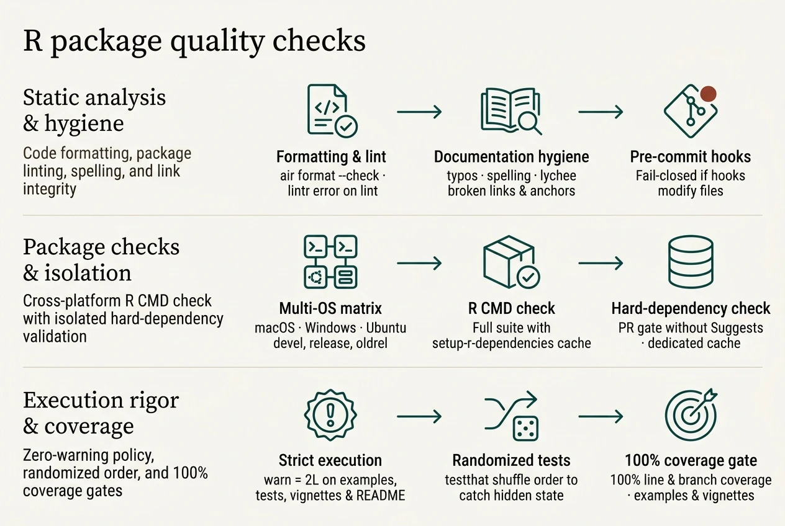
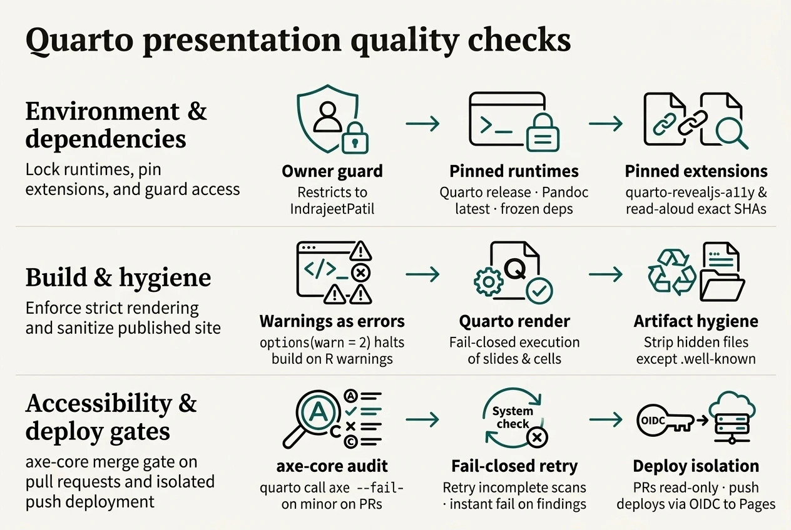

# Workflow catalogue

These reusable workflows run from caller repositories owned by
`IndrajeetPatil`. See [usage](using-workflows.md) for the call pattern and
permissions.

## Python Packages

| Workflow | Description | Inputs / secrets |
|----------|-------------|--------|
| [`python-benchmarks.yaml`](../.github/workflows/python-benchmarks.yaml) | Run CodSpeed CPU simulation benchmarks with OIDC uploads | — |
| [`python-docs.yaml`](../.github/workflows/python-docs.yaml) | Build and deploy Python package documentation to GitHub Pages | — |
| [`python-mutation-test.yaml`](../.github/workflows/python-mutation-test.yaml) | Run `make mutation-test` with mutmut and upload the `mutants/` report | — |
| [`python-qa.yaml`](../.github/workflows/python-qa.yaml) | Code quality checks, including build and test coverage | — |
| [`python-test.yaml`](../.github/workflows/python-test.yaml) | Run tests across multiple OS and Python versions | — |



Python package workflows enforce quality gates across three stages:

- **Environment and static checks:** every run starts with the owner guard
  restricting execution to `IndrajeetPatil` repositories. Dependency resolution
  uses pinned Python versions with locked environments
  (`uv sync --locked --all-extras --dev`). Static QA checks run via `make qa` to
  enforce linting, formatting, and type checks, while `uv build` verifies package
  build hygiene.

- **Test matrix and coverage gates:** tests run across a full operating system
  matrix on Ubuntu across all supported Python versions (3.12 through 3.15), and
  on macOS and Windows for the latest stable release (3.15). Test execution uses
  locked dependencies (`uv run --locked pytest`), and code quality enforcement
  demands 100% test coverage (`coverage report --fail-under=100`), failing closed
  if any code branch or line lacks coverage. Mutation testing runs the
  caller's `make mutation-test` target with mutmut and uploads the `mutants/`
  directory as the `mutmut-report` artifact, even when surviving mutants fail
  the job; callers trigger it on demand or on a schedule because full runs are
  slow.

- **Benchmarks and documentation:** CPU simulation benchmarks run via CodSpeed
  under single-threaded execution with short-lived OIDC uploads. Documentation
  is generated with `zensical build` and deployed to GitHub Pages only on
  default-branch pushes with isolated OIDC write credentials.

The repository's internal zizmor audit enables ANSI color in captured CI logs
with job-level `FORCE_COLOR=1` and `CLICOLOR_FORCE=1`, while retaining its
GitHub annotation format. In the reusable Python and presentation workflows,
color is strictly enabled via command-line flags on `uv` and `pytest`
rather than job-level variables. This prevents ANSI escapes from bleeding into
caller-supplied content such as `prek` hooks, Make targets, or captured
presentation cells. `prek` itself remains colorized via the `prek-action` defaults.

## R Packages

| Workflow | Description | Inputs / secrets |
|----------|-------------|--------|
| [`check-docs.yaml`](../.github/workflows/check-docs.yaml) | Check for broken links using [lychee](https://github.com/lycheeverse/lychee) and spelling using [typos](https://github.com/crate-ci/typos) | — |
| [`check-formatting.yaml`](../.github/workflows/check-formatting.yaml) | Check and suggest code formatting using [air](https://github.com/posit-dev/air) | — |
| [`r-benchmarks.yaml`](../.github/workflows/r-benchmarks.yaml) | Benchmark main R API functions with the CodSpeed executable harness and OIDC uploads | — |
| [`R-CMD-check.yaml`](../.github/workflows/R-CMD-check.yaml) | R CMD check across multiple operating systems plus current, devel, and previous R releases; use `hard: true` for a hard-deps-only CI check (PR-only) | `hard` |
| [`check-extra.yaml`](../.github/workflows/check-extra.yaml) | Parallel extra checks: no-warnings, random test order, README render | `extra-packages` |
| [`lint.yaml`](../.github/workflows/lint.yaml) | Package linting with `{lintr}` | — |
| [`pkgdown.yaml`](../.github/workflows/pkgdown.yaml) | Build and deploy a pkgdown site with verified canonical URLs; use `no-suggests: true` for a hard-deps-only CI check | `no-suggests` |
| [`seo-files.yaml`](../.github/workflows/seo-files.yaml) | Deploy SEO and AI-discovery files (`robots.txt`, `.well-known/llms.txt`) to `gh-pages` after pkgdown build | `package-name` |
| [`submit-cran.yaml`](../.github/workflows/submit-cran.yaml) | On a release branch, build and submit to CRAN without releasing; on the default branch after merge, rebuild and tag the submitted PR head and create a GitHub Release using the matching `NEWS.md` section without resubmitting | — |
| [`test-coverage.yaml`](../.github/workflows/test-coverage.yaml) | Two parallel coverage jobs: unit tests (enforces 100% line and branch coverage) + examples/vignettes (enforces 100%) | Optional `CODECOV_TOKEN`; PR uploads tolerate a missing token |



R package workflows enforce quality gates across three stages:

- **Static analysis and hygiene:** formatting is checked with `air`, and style
  is audited with `{lintr}`, failing on any lint finding. Documentation checks
  guard against link rot and broken anchor fragments with `lychee` while enforcing
  HTTPS, and verify spelling with `typos`. Pre-commit hooks run in a fail-closed
  mode that rejects any changes made by hooks.

- **Package checks and isolation:** R CMD check runs across macOS, Windows, and
  Ubuntu across current, developmental, and previous R releases. Dependencies are
  saved with `cache: always` to preserve dependencies on failed runs. On pull
  requests, a dedicated hard-dependencies check runs with only hard dependencies
  and checking tools in an isolated cache, preventing suggested packages from
  masking undeclared dependencies.

- **Execution rigor and coverage gates:** extra checks run in parallel,
  turning warnings into errors (`warn = 2L`) across examples, tests, vignettes,
  and README rendering. A randomized test order step runs tests with a shuffled
  seed to catch hidden inter-test state dependencies. Strict coverage gates
  require 100% line coverage and 100% branch coverage on unit tests, and 100%
  coverage across all examples and vignettes.

See [hard-dependency checks](r-packages.md#hard-dependency-checks) for checking
tools and isolated caches, and [CRAN releases](r-packages.md#cran-releases) for
the release boundary.

## Presentations

| Workflow | Description | Inputs / secrets |
|----------|-------------|--------|
| [`build-presentation-python.yaml`](../.github/workflows/build-presentation-python.yaml) | Build and deploy Python/UV Quarto RevealJS presentation to GitHub Pages | — |
| [`build-presentation-r.yaml`](../.github/workflows/build-presentation-r.yaml) | Build and deploy R Quarto RevealJS presentation to GitHub Pages | — |



Both presentation workflows enforce quality gates across three stages:

- **Environment and dependencies:** every run starts with the owner guard
  restricting execution to `IndrajeetPatil` repositories. Toolchains use pinned
  Quarto and Pandoc releases with locked dependencies (`uv sync --frozen` for
  Python, `setup-r-dependencies` with `cache: always` for R). Pinned releases of
  [`quarto-revealjs-a11y`](https://github.com/mcanouil/quarto-revealjs-a11y) and
  the [Read Aloud extension](https://github.com/IndrajeetPatil/quarto-read-aloud)
  are installed from exact release archives before rendering. Callers opt in
  with `revealjs-plugins: [read-aloud]`; installation alone does not enable
  speech.

- **Build and hygiene:** rendering fails closed on syntax, code, or template
  errors. The R workflow turns warnings into errors via `options(warn = 2)` in
  `.Rprofile` so evaluation issues fail the build. After rendering, an artifact
  hygiene step prunes all hidden directories and files other than `.well-known`
  from `_site`, preventing `.venv` or temporary dotfiles from publishing.

- **Accessibility and deployment gates:** on pull requests, both workflows run
  Quarto's built-in
  [`quarto call axe`](https://quarto.org/docs/output-formats/html-accessibility.html#site-wide-accessibility-checks)
  accessibility check over the rendered `_site`, skipping Reveal's vendored
  `index_files/` pages. Any axe-core finding fails the pull request
  (`--fail-on minor`); incomplete scans, such as a headless Chrome startup
  failure, are retried up to three times. Pushes skip the check, because
  callers' default branches accept changes only through pull requests that
  already passed it. The check sees each page as loaded, so contrast on later
  slides and content shown only at some fragment steps or in non-default tabs is
  not covered. Pull requests use read-only tokens and never deploy; deployment
  runs only on default-branch pushes via an isolated job with OIDC credentials
  for GitHub Pages.

## Generic

Generic workflows are language-agnostic and provide utility across diverse
types of projects, ensuring high code quality and robust documentation
regardless of the underlying tech stack.

| Workflow | Description | Inputs / secrets |
|----------|-------------|--------|
| [`check-link-rot.yaml`](../.github/workflows/check-link-rot.yaml) | Check for broken links using [lychee](https://github.com/lycheeverse/lychee) | — |
| [`conventional-commits.yaml`](../.github/workflows/conventional-commits.yaml) | Check every pull-request commit and the pull-request title (the default squash subject) against [Conventional Commits](https://www.conventionalcommits.org) | `extra-types` |
| [`e2e.yaml`](../.github/workflows/e2e.yaml) | Run Playwright end-to-end tests against web apps with Vite+, uploading report artifacts | — |
| [`lighthouse.yaml`](../.github/workflows/lighthouse.yaml) | Run Lighthouse CI audits against web apps with Vite+, uploading report artifacts | `command`, `reports-path` |
| [`prek.yml`](../.github/workflows/prek.yml) | Run every [prek](https://prek.j178.dev/) hook in the caller's config, with no `SKIP` list; fails if a hook would modify files | — |
| [`prek-web-app.yml`](../.github/workflows/prek-web-app.yml) | `prek.yml` for web apps: installs Vite+ and the locked dependencies first, and passes hooks no GitHub token | — |

Trigger `conventional-commits.yaml` on the `edited` pull-request activity as
well, so a corrected title is re-checked. Keep it in its own caller workflow:
an `edited` trigger on a heavier workflow would re-run all of it for a title
change.

```yaml
on:
  pull_request:
    branches: [main]
    types: [opened, synchronize, reopened, edited]

permissions:
  contents: read

concurrency:
  group: conventional-commits-${{ github.ref }}
  cancel-in-progress: true

jobs:
  conventional-commits:
    uses: IndrajeetPatil/workflows/.github/workflows/conventional-commits.yaml@main
```
